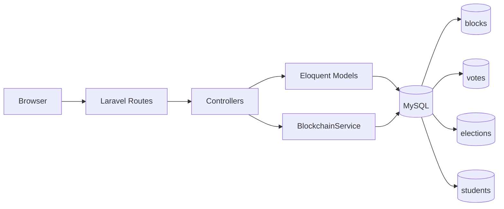
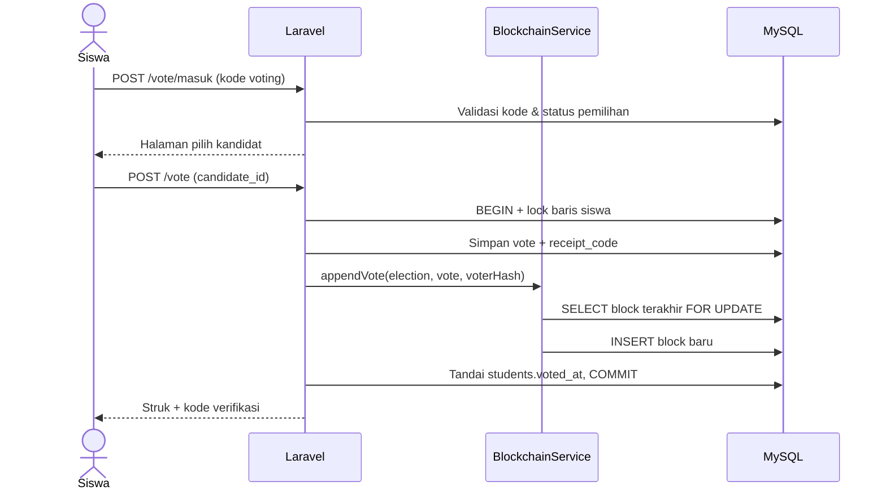
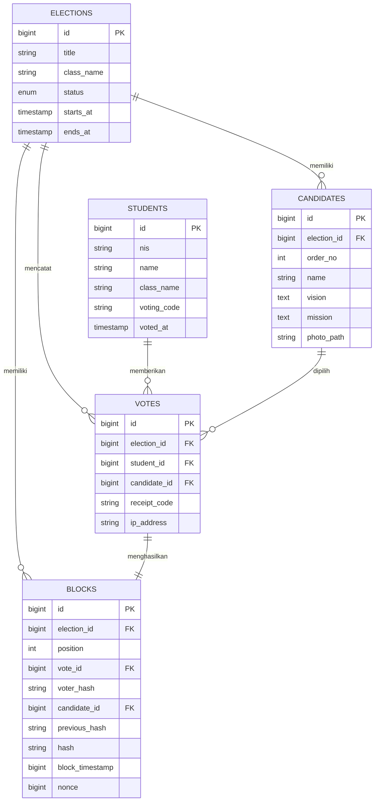

<div align="center">

# E-Voting Ketua Kelas

**Sistem pemilihan ketua kelas dengan pencatatan suara berbasis blockchain (hash-chain).**

Dibangun dengan Laravel 13, MySQL 8, dan Tailwind CSS — setiap suara menjadi block
yang saling terhubung dan dapat diaudit secara publik.

[](https://laravel.com)
[](https://www.php.net)
[](https://www.mysql.com)
[](https://tailwindcss.com)
[](tests)

</div>

> **Catatan:** ini adalah prototipe pembelajaran. Blockchain disimulasikan sebagai
> rantai hash di MySQL, bukan jaringan blockchain terdesentralisasi seperti Ethereum.

---

## Daftar Isi

- [Tentang Proyek](#tentang-proyek)
- [Fitur](#fitur)
- [Demo & Akun](#demo--akun)
- [Arsitektur](#arsitektur)
- [Alur Voting](#alur-voting)
- [Model Data](#model-data)
- [Cara Kerja Blockchain](#cara-kerja-blockchain)
- [Teknologi](#teknologi)
- [Instalasi](#instalasi)
- [Route Penting](#route-penting)
- [Struktur Proyek](#struktur-proyek)
- [Testing](#testing)
- [Batasan](#batasan)

---

## Tentang Proyek

Pemilihan ketua kelas biasanya masih dilakukan secara manual atau menggunakan form
biasa. Proyek ini menambahkan lapisan **integritas data**: setiap suara dicatat
sebagai block yang menyimpan hash block sebelumnya (hash-chain). Jika ada data block
yang diubah, hash tidak lagi cocok dan halaman audit akan menandai rantai sebagai
**TIDAK VALID**.

Sistem mendukung satu pemilihan per kelas dengan dua peran:

| Peran | Akses |
|---|---|
| **Admin / Panitia** | Login email & password, mengelola pemilihan, kandidat, siswa, kode voting, hasil, dan audit. |
| **Siswa** | Vote menggunakan kode sekali-pakai tanpa perlu akun/password. |

## Fitur

- **Pemilihan terkelola** — status draf, berlangsung, dan ditutup; jadwal mulai/selesai opsional.
- **Kode voting sekali-pakai** — setiap siswa mendapat kode unik; kode ditandai terpakai setelah vote.
- **Pencegahan vote ganda** — kombinasi unik `(election_id, student_id)` di level database.
- **Struk suara** — setiap vote menghasilkan `receipt_code` untuk verifikasi publik.
- **Verifikasi publik** — cek kandidat, posisi block, hash, dan status integritas tanpa login.
- **Audit chain** — hitung ulang seluruh hash dan validasi keterkaitan antar block.
- **Privasi pemilih** — block menyimpan `voter_hash` (HMAC-SHA256), bukan identitas mentah.
- **Panel admin** — dashboard partisipasi, CRUD kandidat (dengan foto), CRUD siswa, cetak kode.
- **UI responsif** — Blade + Tailwind CSS via CDN, tanpa build step Node.

## Demo & Akun

Jalankan seeder, lalu gunakan akun berikut:

| Peran | Kredensial |
|---|---|
| Admin | `admin@example.com` / `password` |
| Siswa | Kode voting 6 karakter (tercetak saat seeding) |

Kode siswa juga dapat dilihat dan dicetak dari menu **Admin → Siswa & Kode → Cetak kode**.
Data demo berisi 1 pemilihan aktif, 3 kandidat, dan 20 siswa.

## Arsitektur



- **Controller** menangani validasi, otorisasi, dan transaksi.
- **BlockchainService** membuat genesis block, menambahkan block vote, dan memverifikasi rantai.
- **MySQL** menyimpan data aplikasi sekaligus rantai block.

## Alur Voting



## Model Data



## Cara Kerja Blockchain

1. Saat pemilihan dibuka, sistem membuat **genesis block** (`position = 0`,
   `previous_hash = 64 nol`).
2. Setiap vote menambahkan satu block baru yang menunjuk hash block sebelumnya.
3. Identitas pemilih disamarkan menjadi `voter_hash = HMAC-SHA256(student_id, APP_KEY)`.
4. Hash block dihitung deterministik dari isi block:

```text
hash = SHA-256(
    position | block_timestamp | voter_hash |
    candidate_id | previous_hash | nonce
)
```

5. **Audit** menghitung ulang semua hash, memeriksa `previous_hash`, dan memastikan
   posisi block berurutan. Perubahan satu block memutus rantai dan terdeteksi.
6. `nonce` disediakan untuk proof-of-work ringan. Atur `BLOCKCHAIN_DIFFICULTY`
   (jumlah nol di awal hash); default `0` (tanpa PoW).

> Keterbatasan: hash-chain bersifat *tamper-evident*, bukan *tamper-proof*.
> Pengguna dengan akses penuh ke database masih dapat menulis ulang seluruh rantai.

## Teknologi

| Komponen | Keterangan |
|---|---|
| Framework | Laravel 13 |
| Bahasa | PHP 8.3 |
| Database | MySQL 8 |
| Tampilan | Blade + Tailwind CSS (CDN) |
| Hash | SHA-256 + HMAC-SHA256 |
| Testing | PHPUnit / `php artisan test` |
| Formatter | Laravel Pint |

## Instalasi

**Prasyarat:** PHP >= 8.3, Composer, MySQL 8.

```bash
git clone https://github.com/JoseVanesh/pemilihan-ketua-kelas-blockchain.git
cd pemilihan-ketua-kelas-blockchain

composer install

copy .env.example .env
php artisan key:generate
```

Sesuaikan koneksi database di `.env`:

```env
DB_CONNECTION=mysql
DB_HOST=127.0.0.1
DB_PORT=3306
DB_DATABASE=blockchain_voting
DB_USERNAME=root
DB_PASSWORD=
```

Buat database `blockchain_voting`, lalu siapkan data:

```bash
php artisan db:wipe
php artisan migrate --seed
php artisan storage:link
```

Jalankan aplikasi:

```bash
php artisan serve
```

Buka **http://127.0.0.1:8000**.

> Pada sebagian environment, `php artisan migrate:fresh` tidak menghapus tabel lama
> dengan benar. Gunakan `php artisan db:wipe` sebelum `migrate --seed`.

## Route Penting

### Publik

| Method | Route | Fungsi |
|---|---|---|
| GET | `/` | Landing page & ringkasan pemilihan |
| GET | `/vote` | Form kode voting |
| POST | `/vote/masuk` | Verifikasi kode voting |
| GET | `/vote/kandidat` | Halaman pilih kandidat |
| POST | `/vote` | Kirim suara & buat block |
| GET | `/struk/{code}` | Struk suara |
| GET | `/hasil` | Rekapitulasi hasil |
| GET | `/verifikasi` | Verifikasi struk publik |
| GET | `/audit` | Audit integritas rantai |

### Admin (`/admin`, perlu login)

| Route | Fungsi |
|---|---|
| `/admin` | Dashboard & statistik |
| `/admin/pemilihan` | Pengaturan pemilihan |
| `/admin/kandidat` | CRUD kandidat |
| `/admin/siswa` | CRUD siswa & kode voting |
| `/admin/siswa/cetak-kode` | Halaman cetak kode |
| `/admin/hasil` | Hasil versi admin |
| `/admin/audit` | Audit chain versi admin |

## Struktur Proyek

```text
app/
├── Http/Controllers/
│   ├── Admin/                  # Controller panel panitia
│   ├── VoteController.php      # Alur vote & struk
│   ├── ResultController.php    # Hasil publik
│   ├── VerificationController.php
│   └── AuditController.php
├── Models/                     # Election, Candidate, Student, Vote, Block
└── Services/
    └── BlockchainService.php   # Genesis, append, hash, verify

database/
├── migrations/                 # Skema tabel
└── seeders/                    # Data demo (admin, kandidat, siswa)

resources/views/
├── layouts/                    # Layout publik & admin
├── public/                     # Halaman publik
└── admin/                      # Halaman panel admin

tests/Feature/                  # VotingTest, PagesTest
config/blockchain.php           # Tingkat difficulty PoW
```

## Testing

```bash
php artisan test
```

Cakupan test:

- Vote sah dan pembuatan block
- Penolakan vote ganda dan kode terpakai
- Penolakan saat pemilihan ditutup
- Validasi kandidat
- Deteksi tamper pada rantai
- Verifikasi struk publik
- Autentikasi admin
- Render seluruh halaman publik dan admin

Hasil saat ini: **16 test lulus, 79 assertion**. Format kode dicek dengan:

```bash
php vendor/bin/pint --test
```

## Batasan

- Satu pemilihan aktif per kelas (belum multi-kelas/multi-tenant).
- Blockchain tersimulasi di MySQL, bukan jaringan terdesentralisasi.
- Tabel `votes` tetap menyimpan relasi siswa → suara untuk mencegah vote ganda;
  block hanya menyimpan hash identitas pemilih.
- Hasil publik ditampilkan selama pemilihan berlangsung (bersifat sementara).

---

<div align="center">

Dibuat untuk pembelajaran dan portofolio.

</div>
